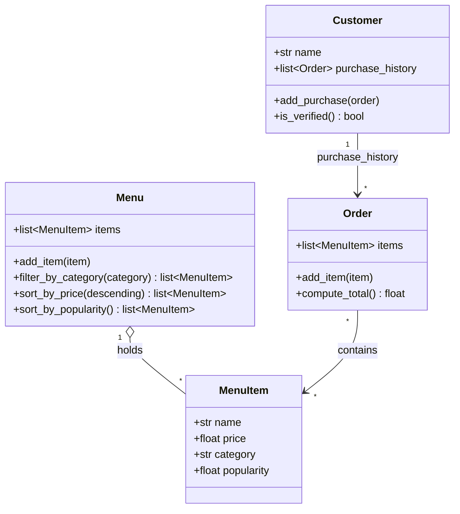

# ByteBites Final UML Design

Revised with `ByteBites_Design_Reference.md` attached, then checked line by line against
the feature request in `bytebites_spec.md`.

## One sentence per class

- **Customer**: a user with a name and a history of past orders. Having at least one past purchase is how the system verifies they are a real user.
- **MenuItem**: one food item for sale, with a name, price, category and popularity rating.
- **Menu**: the full collection of items, which can be filtered by category and sorted.
- **Order**: one transaction that groups the selected items and computes their total cost.

## How this differs from the first draft (`draft_from_copilot.md`)

The first chat had no ground rules, so it invented `User`, `Payment` and
`RecommendationEngine`, plus login, discounts and order status. With the reference file
attached, the assistant stayed within the four classes and the attributes in the spec. The only
additions are methods needed for the spec's behaviors: filtering, sorting, totals and verification.
