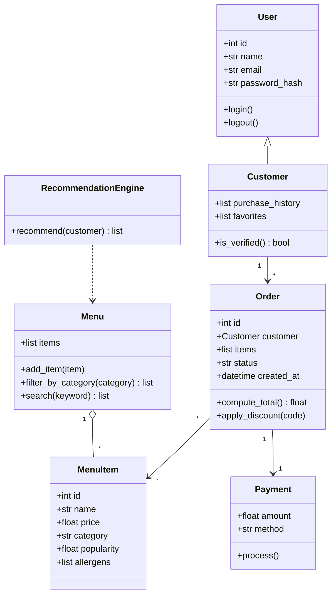

# Draft UML (first pass, no reference file)

This is the first diagram from a chat that only had `bytebites_spec.md` attached.
I'm keeping it to compare against the final design.

## Review notes

- **Adds classes that aren't in my candidate list:** `User`, `Payment`, `RecommendationEngine`.
- **Adds features the spec never asks for:** login and passwords, email, allergens, search, discounts, order status, timestamps, favorites.
- **Matches the spec:** `MenuItem` (name, price, category, popularity), `Menu` with `filter_by_category`, `Order` with `compute_total`, and `Customer` with `purchase_history`.
- **Verdict:** too big. The final design should keep only the four classes and the attributes the feature request describes.
